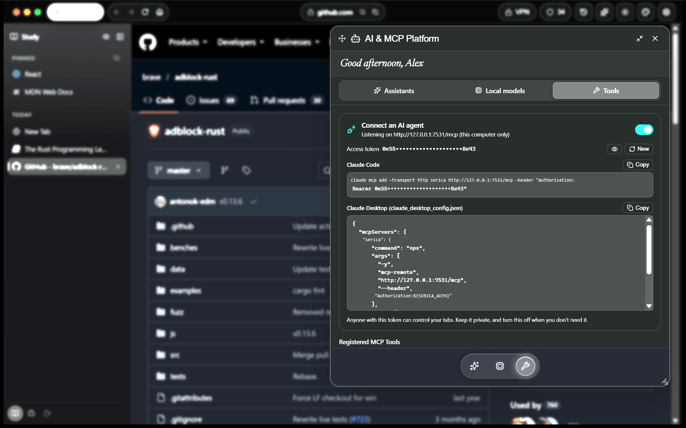

<div align="center">


# Serica

**An open-source, Arc-style browser for Windows.**

[](https://github.com/icesucksatguitar/Serica/releases/latest)
[](LICENSE)


### [⬇ Download the latest release](https://github.com/icesucksatguitar/Serica/releases/latest)

Get the **`.msi` installer** (adds Start menu and desktop shortcuts), or the portable `.exe` if you'd rather not install anything.

</div>

> **Windows SmartScreen:** Serica isn't code-signed yet, so Windows may say it "protected your PC" from an unrecognized app. Click **More info → Run anyway**. The installer also asks for administrator approval, because it installs to Program Files for all users. You can review the source and build it yourself instead (see [Building from source](#building-from-source)).

## Why Serica

Arc stops working on **December 22, 2026**. Serica keeps the parts of Arc that people miss: Spaces, a vertical sidebar with pinned and Today tabs, a command palette and per-space themes. It's open source and MIT-licensed, so it can't be sunset out from under you. It's a native Rust app on Microsoft's WebView2, so sites render with the same Chromium engine as Edge and the installer is about 5 MB. Ad and tracker blocking is built in, and a local MCP endpoint lets AI agents like Claude drive your tabs when you allow it.

## Features

### Spaces and the sidebar


- **Spaces** for separate contexts (Study, Work, Leisure, or your own). Switch with <kbd>Ctrl</kbd>+<kbd>1</kbd>–<kbd>9</kbd>. Each space can use its own profile, so cookies and logins stay separate.
- **Vertical sidebar** with **Pinned** tabs, folders and a **Today** section. Today tabs you haven't touched in 12 hours move to an archive you can restore from (the interval is configurable).
- **Tab previews** on hover, a favorites dock, and a media mini player for audio playing in another tab.

### Command palette


<kbd>Ctrl</kbd>+<kbd>K</kbd> or <kbd>Ctrl</kbd>+<kbd>L</kbd> opens a URL, searches the web, or jumps to an open tab in any space. Type `>` for commands such as settings, themes, shields, downloads, extensions and tab hibernation.

### Theme Studio


Each space gets its own gradient theme. Pick colors on a wheel, adjust intensity and grain, switch light/dark/auto, or start from one of 10 presets. The new-tab page has an animated ambient glow with adjustable strength, speed and spread.

### Shields: built-in ad and tracker blocking


Shields uses Brave's open-source [`adblock-rust`](https://github.com/brave/adblock-rust) engine with EasyList, EasyPrivacy and uBlock Origin's filter lists, covering network requests, cosmetic filters and scriptlets. Lists update in the background. You can allow a site with one click and see a live list of recent blocks.

### Tab hibernation
Background tabs that sit idle for 10 minutes are put to sleep to free memory, and wake when you return to them. Pinned and playing tabs stay awake. You can also hibernate every inactive tab at once from the command palette.

### Built-in MCP for AI agents


Serica can expose a local [Model Context Protocol](https://modelcontextprotocol.io) endpoint so agents can control the browser. See [Connect Claude to Serica](#connect-claude-to-serica).

### Also included
- **Chrome Web Store extensions.** Open an extension's store page and press **Add to Serica**, then manage extensions at `serica://extensions`.
- **Download manager** (<kbd>Ctrl</kbd>+<kbd>J</kbd>) with pause, resume, cancel and retry.
- **Privacy tunnel:** DNS-over-HTTPS, Tor (SOCKS5) or your own SOCKS5/HTTP proxy, with an optional kill switch.
- **History** with search, find in page, zoom, and HTML fullscreen.

## Connect Claude to Serica

1. In Serica, open **AI Assistants & Tools** (the sparkle button in the top bar) → **Tools**, and turn on **Connect an AI agent**.
2. The panel shows your endpoint (`http://127.0.0.1:7531/mcp`) and a private access token, with copy buttons for each config below.

**Claude Code**

```bash
claude mcp add --transport http serica http://127.0.0.1:7531/mcp --header "Authorization: Bearer <your-token>"
```

**Claude Desktop** (`claude_desktop_config.json`, through [`mcp-remote`](https://www.npmjs.com/package/mcp-remote); requires Node.js)

```json
{
  "mcpServers": {
    "serica": {
      "command": "npx",
      "args": ["-y", "mcp-remote", "http://127.0.0.1:7531/mcp", "--header", "Authorization:${SERICA_AUTH}"],
      "env": { "SERICA_AUTH": "Bearer <your-token>" }
    }
  }
}
```

**Tools:** `browser_get_status`, `browser_list_tabs`, `browser_navigate`, `browser_create_tab`, `browser_close_tab`, `browser_zen_optimize`, `browser_media_control`, `browser_get_adblock_stats`.

The endpoint is off by default and listens only on `127.0.0.1`. Every request needs the token, and requests from web pages (non-local origins) are refused. Anyone with the token can control your tabs, so keep it private; you can issue a new one from the same panel.

## Roadmap

- [x] Rust + Tauri v2 rewrite (the Electron prototype has been retired)
- [x] Chrome Web Store extensions, download manager, MCP endpoint
- [ ] Arc importer (Spaces, pinned tabs and folders)
- [x] MSI installer with Start menu and desktop shortcuts
- [ ] Auto-update
- [ ] Code signing, to remove the SmartScreen warning
- [ ] Password manager

## Building from source

<details>
<summary>Prerequisites and commands</summary>

**Requirements:** Windows 10/11 with the WebView2 Runtime (preinstalled on current Windows), [Rust](https://rustup.rs) 1.80+, Node.js 20+, and the Visual Studio C++ Build Tools.

```bash
git clone https://github.com/icesucksatguitar/Serica.git
cd Serica/rust
npm install
npm run tauri dev        # run with hot reload
```

Release build (stages `release/rust/Serica.exe`):

```bash
cd Serica
python build.py --bump none     # or: --bump patch | minor | major, --clean, --run
```

Tests:

```bash
cd rust/src-tauri && cargo test
cd rust && npx tsc --noEmit
```

Architecture notes and module overview: [`rust/README.md`](rust/README.md).

</details>

## How this was built

I designed and directed Serica. AI coding agents wrote much of the implementation, and I [FILL IN: what you debugged or wrote yourself].

## Contributing

Issues and pull requests are welcome. For larger changes, please open an issue first so we can agree on the approach. Before submitting, run `cargo test` in `rust/src-tauri` and `npx tsc --noEmit` in `rust/`.

## License

[MIT](LICENSE)
