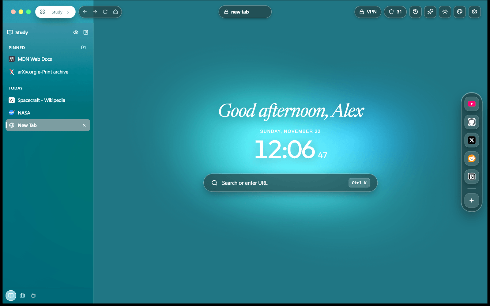
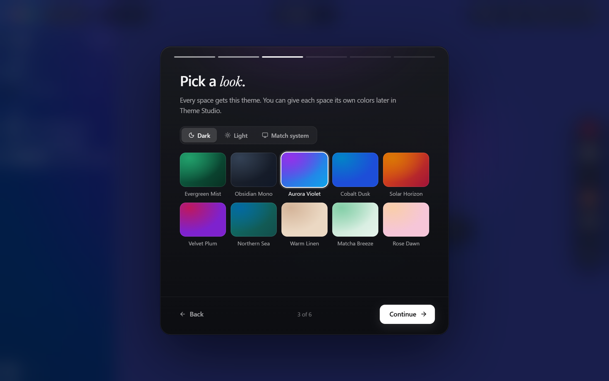
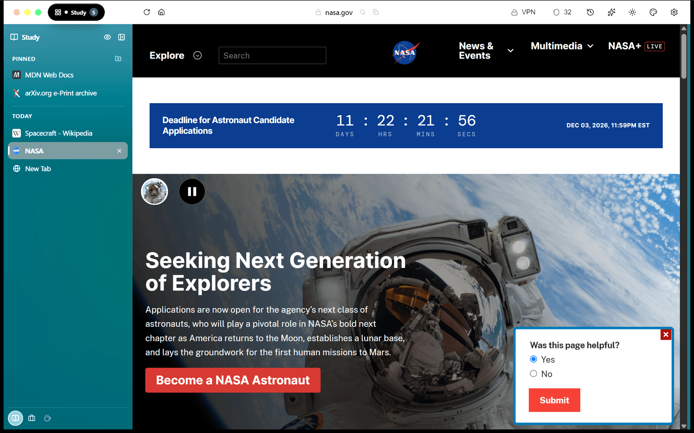
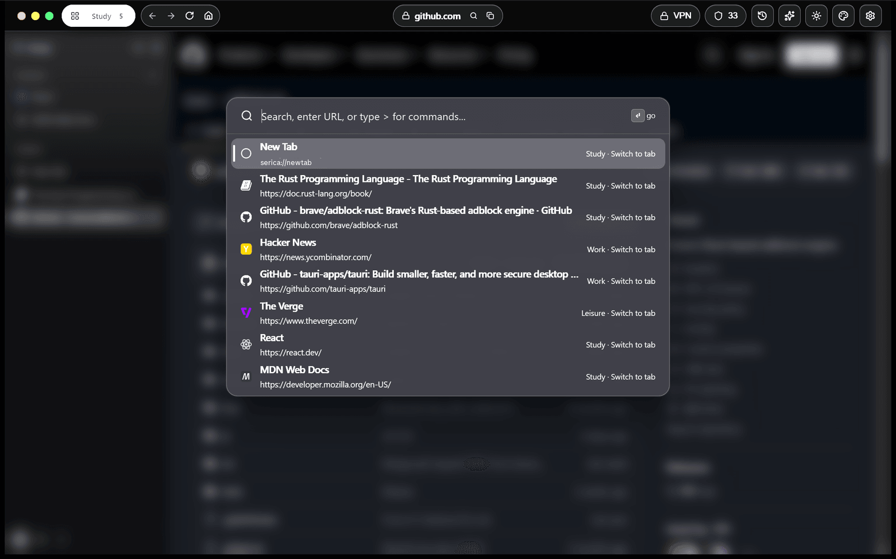
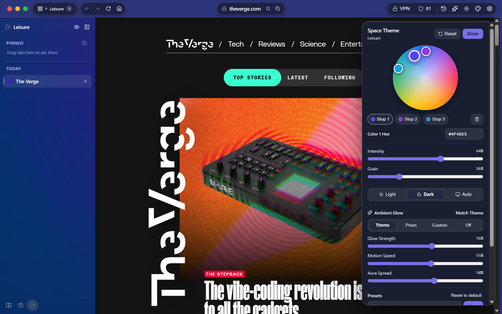
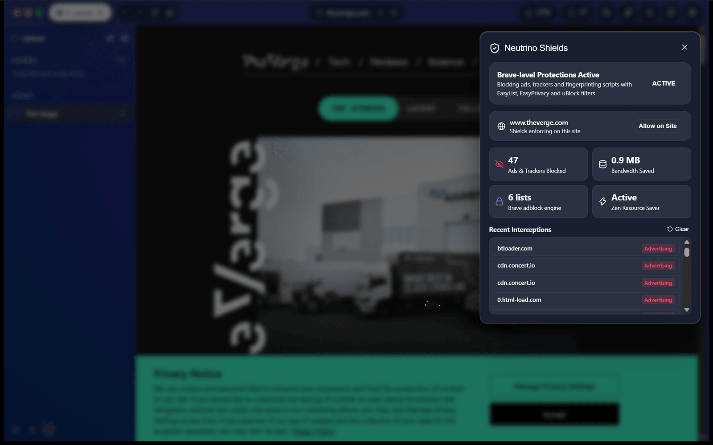

<div align="center">


# Serica

**An open-source, Arc-style browser for Windows.**

[](https://github.com/icesucksatguitar/Serica/releases/latest)
[](LICENSE)




### [⬇ Download Serica for Windows (.msi)](https://github.com/icesucksatguitar/Serica/releases/latest/download/Serica-Setup-x64.msi)

The installer adds Start menu and desktop shortcuts. Prefer not to install anything? Grab the portable `.exe` from the [releases page](https://github.com/icesucksatguitar/Serica/releases/latest).

</div>

> **Coming from Neutrino?** Serica is the new name for Neutrino. The installer replaces Neutrino and keeps your tabs, spaces, settings and logins.

> **Windows SmartScreen:** Serica isn't code-signed yet, so Windows may say it "protected your PC" from an unrecognized app. Click **More info → Run anyway**. The installer also asks for administrator approval, because it installs to Program Files for all users. You can review the source and build it yourself instead (see [Building from source](#building-from-source)).

## Why Serica

Arc stops working on **December 22, 2026**. Serica keeps the parts of Arc that people miss: Spaces, a vertical sidebar with pinned and Today tabs, a command palette and per-space themes, and adds a Cold Turkey-style Focus Mode. It's open source and MIT-licensed, so it can't be sunset out from under you. It's a native Rust app on Microsoft's WebView2, so sites render with the same Chromium engine as Edge and the installer is about 5 MB. Ad and tracker blocking is built in, and a local MCP endpoint lets AI agents like Claude drive your tabs when you allow it.

## Features

### Set up in a minute


Setup brings over bookmarks, history and passwords from Chrome, Edge, Brave, Vivaldi, Opera or Firefox, asks for a sidebar or top tabs, a look (light, dark or match Windows, a palette and a new-tab background), and can make Serica your default browser. A short tour then shows the address bar, the sidebar, widgets, Theme Studio and Focus Mode. Updating from an earlier Serica opens setup once and keeps everything you have: tabs, spaces, sign-ins, cookies, passwords and settings.

### Spaces and the sidebar


- **Spaces** for separate contexts (Study, Work, Leisure, or your own). Switch with <kbd>Ctrl</kbd>+<kbd>1</kbd>–<kbd>9</kbd>, or swipe sideways on the sidebar. Each space can use its own profile, so cookies and logins stay separate.
- **Vertical sidebar** that slides in over the page (<kbd>Ctrl</kbd>+<kbd>S</kbd>, the space button, or the left edge of the window) without pulling down an auto-hidden top bar, with **Pinned** tabs, folders and a **Today** section. Back, forward and reload move into its top row while it's open. Today tabs you haven't touched in 12 hours move to an archive you can restore from (the interval is configurable).
- **Tab previews** on hover, and a picture-in-picture mini player when you leave a tab with a playing video.
- Prefer a classic layout? Switch to **top tabs** in Settings → Appearance.

### The new tab
Only your widgets and the clock (with an optional greeting in **Customize**): press and hold a widget to move it anywhere on the grid (the others make room), resize it, or set it up; widgets are liquid glass that takes on the colours behind it. The background can be your space's colours, a solid colour, a gradient, your own picture, or **Serica Special**: three oil-pastel paintings after French Revolution-era art, crossfading slowly.

### Focus Mode
Block the sites that pull you away, Cold Turkey style: exact domains, `*.wildcards`, paths, categories and exceptions, for a set time or on a weekly schedule. Blocking happens in the request pipeline of every tab, profile and window, before the site is contacted, and shows a calm block page. A locked list can't be stopped, loosened or deleted until its time is up, not even by restarting Serica or moving the clock. **Statistics** show time focused, sessions kept, a streak, what you reached for while it was blocked and at what hour, and where your browsing time went, by day, week, month or year, with CSV export. Everything stays on your PC.

### Website dock
One-click sites on the right edge of the window. On web pages it stays tucked away until you move the cursor to the right edge. Right-click the dock to add a site or hide it; turn it back on in Settings → Appearance.

### Command palette


<kbd>Ctrl</kbd>+<kbd>K</kbd> or <kbd>Ctrl</kbd>+<kbd>L</kbd> opens a URL, searches the web, or jumps to an open tab in any space. Type `>` for commands such as settings, themes, shields, downloads, extensions and tab hibernation.

### Theme Studio


Each space gets its own theme from curated palettes (or a hue of your own), light, dark or matching Windows, with a live preview; text contrast is kept readable whatever you pick.

### Shields: built-in ad and tracker blocking


Shields uses Brave's open-source [`adblock-rust`](https://github.com/brave/adblock-rust) engine with EasyList, EasyPrivacy and uBlock Origin's filter lists, covering network requests, cosmetic filters and scriptlets. Lists update in the background. You can allow a site with one click and see a live list of recent blocks.

### Tab hibernation
Background tabs that sit idle for 1 hour by default (configurable from 15 minutes to 12 hours, and sooner when memory runs low) are put to sleep to free memory, and wake when you return to them. Pinned and playing tabs stay awake. You can also hibernate every inactive tab at once from the command palette.

### Built-in MCP for AI agents


Serica can expose a local [Model Context Protocol](https://modelcontextprotocol.io) endpoint so agents can control the browser. See [Connect Claude to Serica](#connect-claude-to-serica).

### Also included
- **Text size** for the whole browser (Small, Default, Large, Larger) in Settings → Appearance; new web pages open at the same size.
- **Chrome Web Store extensions.** Open an extension's store page and press **Add to Serica**, then manage extensions at `serica://extensions`.
- **Download manager** (<kbd>Ctrl</kbd>+<kbd>J</kbd>) with pause, resume, cancel, retry, and drag-out for finished files.
- **Import** bookmarks, history and saved passwords from other browsers on this PC, or a passwords CSV, in Settings → General.
- **Default browser**: one button in Settings → General.
- **Drag and drop** links, text and files onto the window to open them, and Serica's own prompts for camera, microphone, location and notifications.
- **Privacy tunnel:** DNS-over-HTTPS, Tor (SOCKS5) or your own SOCKS5/HTTP proxy, with an optional kill switch.
- **Auto-updates** in the background with an update reminder popup, plus quick UI patches that apply without reinstalling.
- **History** with search, find in page, zoom, and HTML fullscreen.

## Connect Claude to Serica

1. In Serica, click **‹** at the top right to slide out the browser tools, open **AI Assistants & Tools** (the sparkle button) → **Tools**, and turn on **Connect an AI agent**.
2. The panel shows your endpoint (`http://127.0.0.1:7531/mcp`) and a private access token, with copy buttons for each config below.

**Claude Code**

```bash
claude mcp add --transport http serica http://127.0.0.1:7531/mcp --header "Authorization: Bearer <your-token>"
```

**Claude Desktop** (`claude_desktop_config.json`, through [`mcp-remote`](https://www.npmjs.com/package/mcp-remote); requires Node.js)

```json
{
  "mcpServers": {
    "serica": {
      "command": "npx",
      "args": ["-y", "mcp-remote", "http://127.0.0.1:7531/mcp", "--header", "Authorization:${SERICA_AUTH}"],
      "env": { "SERICA_AUTH": "Bearer <your-token>" }
    }
  }
}
```

**Tools:** `browser_get_status`, `browser_list_tabs`, `browser_navigate`, `browser_create_tab`, `browser_close_tab`, `browser_zen_optimize`, `browser_media_control`, `browser_get_adblock_stats`.

The endpoint is off by default and listens only on `127.0.0.1`. Every request needs the token, and requests from web pages (non-local origins) are refused. Anyone with the token can control your tabs, so keep it private; you can issue a new one from the same panel.

## Roadmap

- [x] Rust + Tauri v2 rewrite (the Electron prototype has been retired)
- [x] Chrome Web Store extensions, download manager, MCP endpoint
- [ ] Arc importer (Spaces, pinned tabs and folders)
- [x] MSI installer with Start menu and desktop shortcuts
- [x] Auto-update
- [ ] Code signing, to remove the SmartScreen warning
- [ ] Password manager

## Building from source

<details>
<summary>Prerequisites and commands</summary>

**Requirements:** Windows 10/11 with the WebView2 Runtime (preinstalled on current Windows), [Rust](https://rustup.rs) 1.80+, Node.js 20+, and the Visual Studio C++ Build Tools.

```bash
git clone https://github.com/icesucksatguitar/Serica.git
cd Serica/rust && npm install && cd ..
python build.py          # a menu of everything below
```

Everything goes through `build.py` (or `.\build.ps1` with the same options as `-switches`). `python build.py --help` lists every flag.

**Try it out.** Nothing is shipped, and your everyday Serica profile is never touched:

```bash
python build.py --test            # build an optimized "Serica Test" copy and open it
python build.py --test --fresh    # ...with an empty test profile (first-run setup again)
python build.py --dev             # hot reload while you edit the UI
```

The test copy (`release/test/Serica-Test.exe`) has its own identifier, `com.serica.browser.test`, set in `rust/src-tauri/tauri.test.conf.json`. That gives it its own profile folder, and it opens even while your installed Serica is running. It never auto-updates or loads UI patches, so it always shows exactly the code you built. A log window opens next to it.

**Local build** (stages `release/rust/Serica.exe`; it uses your real profile):

```bash
python build.py                   # or --bump patch | minor | major, --clean, --run
```

**Shipping to users.** There are two ways:

1. **Full release:** for any change, Rust included. Installed copies offer the update and run the new installer.

   ```bash
   python build.py -b patch --bundle            # signed MSI + latest.json in release/github
   git commit -am "Version X.Y.Z" && git push
   python build.py --publish-release            # uploads as a draft GitHub release
   python build.py --publish-release --live     # ...or publishes it and marks it Latest
   ```

   Signing needs the updater key at `~/.tauri/serica-updater.key`, and publishing needs the GitHub CLI (`gh`).

2. **UI patch:** for React/CSS-only fixes, with no installer and no reinstall. Running copies download it in the background (15 s after launch, then every 30 min) and offer a one-click **Reload** that swaps it in within a second. If you dismiss it, the patch is used on the next launch. A patch that fails to render is rolled back automatically. The script refuses to make one if Rust code changed since the release users run; those changes need a full release.

   ```bash
   python build.py --ui-patch --notes "Smoother sidebar"            # stage in release/ui-patch
   python build.py --ui-patch --notes "Smoother sidebar" --publish  # ...and upload it
   ```

`python build.py --status` shows what's built and staged.

Tests:

```bash
cd rust/src-tauri && cargo test
cd rust && npx tsc --noEmit && npm test
```

Architecture notes and module overview: [`rust/README.md`](rust/README.md).

</details>

## How this was built

I designed and directed Serica. AI coding agents wrote much of the implementation.

## Contributing

Issues and pull requests are welcome. For larger changes, please open an issue first so we can agree on the approach. Before submitting, run `cargo test` in `rust/src-tauri` and `npx tsc --noEmit` in `rust/`.

## License

[MIT](LICENSE)
